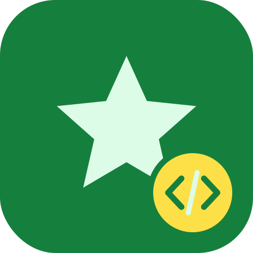

# firstQt

<p align="center">
  
</p>

A first Qt desktop application in C++, written as a learning project.

## What it does

The main window has two buttons:

- **CURL get** fetches a web page with libcurl and shows it in a text
  box.
- **Query Database** runs a query against a MySQL database through the
  Qt `QMYSQL` driver and shows the results.

The database connection settings are hardcoded in `db.cpp`.

## Tech

- C++ and Qt (qmake project `firstQt.pro`)
- libcurl and MySQL

## Building

```sh
qmake firstQt.pro
make
./firstQt
```

## License

Licensed under the Apache License 2.0. See [LICENSE](LICENSE).
